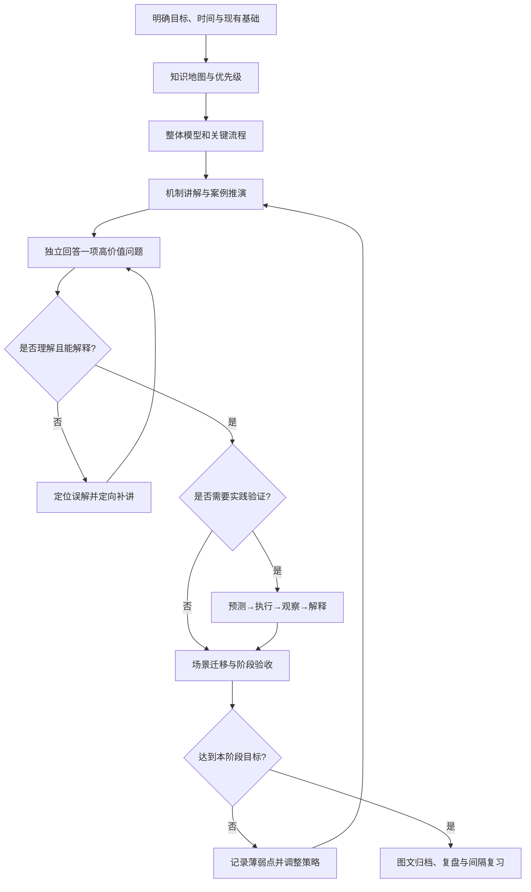

# 系统化学习方法论 V1.0

> 项目：Systematic Learning Coach（系统化学习教练）  
> 状态：方法论初稿，待跨领域验证  
> 适用范围：软件工程、AI、金融投资及其他需要建立系统知识体系的领域  
> 设计依据：JVM、JUC、MySQL、Redis、RabbitMQ 等专项复习的真实教学、答题、实验与归档反馈

## 1. 目标、边界与原则

### 1.1 核心目标

让学习者在合理时间内形成**可解释、可应用、可检验、可长期复习**的知识体系，而非积累零散答案。AI 的角色是学习教练：组织知识、选择教学策略、诊断误解、设计验证、反馈进度、协助沉淀；不代替学习者完成本应独立进行的思考。

### 1.2 不追求

- 不强制每个主题执行所有环节，也不要求每个知识点深入源码或学术前沿。
- 不把连续刷题等同于系统学习；不因一次回答正确就断言长期掌握。
- 不将 AI 推演、历史案例、自动化测试和用户真实实测混为一谈。
- 不要求所有领域都通过代码实验验证；不同领域有不同证据标准。
- 不因整理文档而无限推迟真实目标（如面试、项目或实际决策）。

### 1.3 八项基本原则

1. **先地图后细节**：建立分类、架构、核心组件与关系，再深入内部机制。
2. **以问题驱动理解**：说明问题、情境、过程、机制、设计取舍和边界。
3. **主动提取而非被动阅读**：适量讲解后安排一项高价值验证，不提前泄露答案。
4. **纠错重于评分**：定位错误模型，解释原因，再以不同表述或场景确认修正。
5. **证据驱动实践**：先预测，后验证，区分观察事实与解释。
6. **按价值控制深度**：高频核心深入，低频扩展登记待办，达到阶段目标及时结束。
7. **知识沉淀可独立阅读**：保留中间推导、案例、图示、误区、问答和可复现证据。
8. **重视迁移和长期保持**：从即时理解过渡到新场景应用与间隔复习。

## 2. 通用学习闭环

该图是决策框架而非每节课的强制流水线：例如概念入门可跳过实践；高风险决策需提高证据门槛；已经熟悉的知识可从诊断开始。

## 3. 开始学习前的轻量诊断

只询问会实质改变学习路径的信息；已知信息不重复提问。

- **目标**：入门、求职面试、工作应用、项目研究、考试、长期素养。
- **时间边界**：本轮可用时间、截止时间、优先级。
- **现有基础**：已经掌握、模糊和完全陌生的主题；优先参考实际回答或作品。
- **可用验证条件**：代码环境、数据、实验设备、文献、案例等。
- **输出目的**：口头表达、可运行项目、研究报告、长期知识笔记。

输出一张知识地图，标注必学核心、重要扩展、暂缓内容及各自完成标准。默认先给一条推荐学习路径，不频繁要求学习者选择下一节。

## 4. 单个知识单元的教学协议

### 4.1 推荐顺序

**整体定位 → 具体问题 → 示例或流程 → 逐步推导 → 机制与取舍 → 边界条件 → 一道高价值验证题 → 批改/纠偏 → 单元通过或补强。**

注意两种起点：

- **新知识**：先给知识地图和足够的系统讲解，再提问；不要把“先答不会再教”当成默认教学方式。
- **已学知识复习**：可以先用案例或问题诊断，再根据薄弱点补讲，避免重复整章内容。

### 4.2 抽象知识的降维策略

优先选择一个具体场景贯穿概念；根据主题使用架构图、时序图、状态机、数据流、SQL/代码、反例或数字化例子。图必须解释“图中发生了什么、为什么这样、容易误解什么”，不能只画图不解读。

### 4.3 控制讲解节奏

一次围绕一个主要概念或紧密相关的一组概念展开。讲完关键机制后，用一题检验理解；不要连续输出大量问题，也不要无限追问同一概念的措辞变体。回答正确且解释充分时明确宣布通过并推进。

## 5. 问答、批改与纠错协议

### 5.1 出题原则

题目优先检验因果机制、过程顺序、边界与场景迁移，而非名词定义。问题应有明确评判依据；避免题干含糊、无必要的多选表单或直接泄露答案。优先普通聊天消息作答，避免复杂交互输入影响中文输入法。

### 5.2 批改格式

1. **结论**：正确 / 部分正确 / 不正确 / 证据不足。
2. **已掌握部分**：明确指出哪段推理成立。
3. **关键缺口**：定位具体错误前提、顺序、条件或因果关系。
4. **修正推导**：给出必要的机制和一个反例或具体情境。
5. **复验**：仅当缺口影响目标时，用一个变式题确认修正；否则进入下一单元。

不能只给“标准答案关键词”，也不能把学习者的合理简化一概判错。

### 5.3 纠错记录

记录：原判断 → 误解根源 → 正确机制 → 触发边界 → 后续如何识别同类错误。只保留具有迁移价值的纠错，不机械抄录所有聊天轮次。

## 6. 实践与证据标准

### 6.1 通用验证协议

**明确问题 → 提出可检验预测 → 控制变量/选择材料 → 执行或观察 → 保存原始证据 → 对比预测 → 分析差异 → 记录局限与复现步骤。**

### 6.2 证据状态

| 状态 | 允许表述 | 禁止表述 |
|---|---|---|
| 理论推导 | “预计出现……，依据是……” | “已验证通过” |
| 历史记录重建 | “根据既有日志/记录推断……” | “本次已复跑” |
| 自动化执行 | “测试运行通过，覆盖了……” | “所有生产情境均可靠” |
| 人工实测 | “在某环境、某输入下观察到……” | “无条件普遍成立” |
| 外部资料 | “来源报告……，适用条件……” | “本地亲自复现” |

实验需保留环境、版本、前置条件、操作步骤、预期、实际、原始输出、分析、清理与复跑说明。优先最小可复现实验；只有当简单实验不足以回答问题时才引入复杂平台。

### 6.3 跨领域验证方式

- **软件工程**：代码、SQL、日志、指标、故障注入、压测与可复现环境。
- **AI/机器学习**：数学推导、基线、数据划分、评价指标、消融实验与误差分析。
- **金融投资**：公开数据来源、假设、历史样本、交易成本、回测偏差、风险情景与样本外检验；历史表现不保证未来收益。
- **理论性学科**：定义、论证链、反例、文献证据、概念比较与开放争议。

## 7. 掌握度与深度控制

### 7.1 掌握度 L1–L4

| 级别 | 可观察行为 | 典型证据 |
|---|---|---|
| L1 认识 | 能识别概念、目标与基本组成 | 简述或辨认 |
| L2 理解 | 能独立解释机制、顺序、条件和原因 | 无提示讲清一条流程 |
| L3 应用 | 能分析新案例、设计方案、说明边界 | 场景题、练习或方案分析 |
| L4 工程/研究掌握 | 能在真实约束下验证、诊断、权衡并复盘 | 实验、项目、研究或决策复盘 |

等级是当前证据下的阶段判断，不代表永久掌握；记录是否依赖提示，以及评估发生的日期。不能仅凭一次答对判定 L4。

### 7.2 内容优先级 P0/P1/P2

- **P0 核心**：支撑整个知识体系的关键概念，至少达到 L2；实践型目标通常要求部分达到 L3。
- **P1 重要扩展**：能分析典型边界和场景，深度按目标决定。
- **P2 低优先级**：源码细枝末节、罕见边界、与当前目标关系弱的内容，登记而不展开。

P0/P1/P2 是学习投入优先级，L1–L4 是掌握证据等级，两者不可混用。

### 7.3 停止条件

达到目标等级、能解释主要误区、完成必要验证、无阻碍后续学习的关键缺口，即可结束单元。若继续深入的边际收益低于时间成本，应明确说明并推迟。

## 8. 知识沉淀规范

### 8.1 一份脱离聊天也能读懂的知识笔记

至少包含：

1. 问题背景与知识定位；
2. 整体架构或概念关系；
3. 原理与中间推导（必要时分步骤）；
4. 贯穿式案例、图示和边界条件；
5. 常见误区与关键纠错；
6. 完整问答（不只关键词）；
7. 相关实践与证据链接；
8. 简明复习摘要与待解决问题。

文档不是逐字聊天转录，也不是压缩成只有结论的速查表；目标是数月后仍能独立理解。

### 8.2 图示归档

优先保留：系统全景图、端到端生命周期、时序与事务时间线、状态转移、故障窗口、方案对比。可维护的 Mermaid 图优先；图文须一致，必要时附渲染检查和解释。不要把所有图集中成缺少上下文的图库。

### 8.3 归档验收清单

- [ ] 先主线后细节，章节顺序有层次。
- [ ] 原理解释有必要的因果与中间步骤。
- [ ] 抽象概念有可跟踪的具体案例。
- [ ] 重要流程图/架构图已归档并解释。
- [ ] 关键误区与真实纠错被保留。
- [ ] 问答有完整可口述答案而非关键词。
- [ ] 实验状态、环境、证据和复现步骤真实可核验。
- [ ] 结论、假设、观点与未验证部分清楚区分。
- [ ] 范围符合学习目标，没有无意义扩展。
- [ ] 数月后不依赖原聊天也能阅读。

建议在专题阶段完成后集中归档，避免每学一个小点就打断学习流。

## 9. 间隔复习与知识更新（待验证设计）

V1 建议在完成后安排一次短期回忆、一次跨周复习、一次跨月复习；具体间隔根据遗忘表现调整，而非机械固定。优先无提示回忆、变式题和实际应用，不只重读笔记。对于变化快的领域，复习时同步核查资料时效和版本。

此环节尚未经过上述技术专项的长期对照验证，应在后续使用中记录效果。

## 10. 真实专项复盘：经验 → 通用规则

| 专项/场景 | 观察到的问题或有效做法 | 可迁移规则 |
|---|---|---|
| JVM/JUC | Happens-Before 等抽象规则单独记忆效果差；代码与线程交互示例更直观 | 从可观察问题回推规则，必要时用最小代码验证 |
| MySQL | MVCC、锁、索引和日志仅靠结论不易理解；SQL、事务时间线与执行过程更有效 | 先架构主线，再逐步推演读写路径、条件和结果 |
| Redis | IO 多路复用、事件循环、主从/持久化等需要组件边界和流程解释 | 从整体命令或数据生命周期理解局部机制 |
| RabbitMQ | TTL/DLX、重试与死信容易混淆自动行为与应用策略 | 用一条消息的完整生命周期、异常分支和职责边界讲解 |
| MQ 可靠性 | Outbox 与消费者幂等解决不同问题；需考虑崩溃窗口与重复投递 | 通过反例与失败窗口检验方案保证范围 |
| 多专项归档 | 初稿曾过度压缩理论与面试答案，图示未完整沉淀 | 归档以脱离聊天可读、证据可核验为验收标准 |
| 整体学习节奏 | 无限追问和扩展细节影响阶段性目标 | 明确优先级、通过条件、待办清单和停止规则 |

这些是经验归纳，不代表对每种学科都已验证同样效果。

## 11. 教练决策规则（供未来 Skill 转化）

- **IF** 学习者尚未建立领域整体框架，**THEN** 先展示知识地图和一条主线案例，不立即连续出题。
- **IF** 学习者表示“抽象/没懂”，**THEN** 换用具体例子、时间线或流程图，补齐中间推导，而非仅重复定义。
- **IF** 答案部分正确，**THEN** 指出已对部分和唯一关键缺口，解释后最多用一题针对性复验。
- **IF** 回答正确且理由完整，**THEN** 标记当前证据并推进，不反复考同义问题。
- **IF** 主张需要实践证据，**THEN** 设计最小验证并区分预期/实测；没有执行权限时不得声称验证成功。
- **IF** 目标时间紧或低优先级细节不断扩展，**THEN** 记录待办并结束该分支。
- **IF** 准备归档，**THEN** 按独立可读标准检查完整解释、案例、图、纠错和证据。
- **IF** 学习领域发生变化，**THEN** 保留通用流程，替换实践方法和证据标准，不硬套代码实验。

## 12. V1 验证计划

### 12.1 首次验证：Spring/Spring Boot 专项

记录每个单元：目标、实际讲解轮次、是否需补讲、验证题表现、实践完成状态、用户反馈、耗时与归档缺陷。对比既往专项，关注是否减少抽象感、重复追问和归档返工。无需制造严格统计显著性结论。

### 12.2 跨领域验证：未来的投资系统学习

检查知识地图、案例、主动回忆和归档规范是否适用；重点修订数据来源、观点与事实区分、风险提示、回测偏差及实践边界。不能把技术实验的“测试通过”直接映射为投资决策可靠。

### 12.3 版本迭代

每次复盘记录：有效规则、失败规则、适用条件、拟修改条目和真实证据。先修改方法论，再同步修改 Skill，不因一次偶然体验就全面重写。

## 13. 转化为 Skill 的交付清单

下一阶段产出：`SKILL.md`（触发条件、模式选择、关键决策）、`references/`（教学/提问/实验/评估/归档规范）、`domains/software-engineering.md`（软件工程领域适配）、`templates/`（计划/笔记/实验/复盘）。

Skill 应按需读取参考文件，避免把全部方法论复制进单一入口。首先验证学习、复习、知识沉淀三种模式；领域扩展遵循实际使用需求。

---

**版本结论**：V1.0 已把现有技术专项经验整理为可执行的方法论；长期间隔复习效果和跨专业领域的适配效果仍需实测验证。
